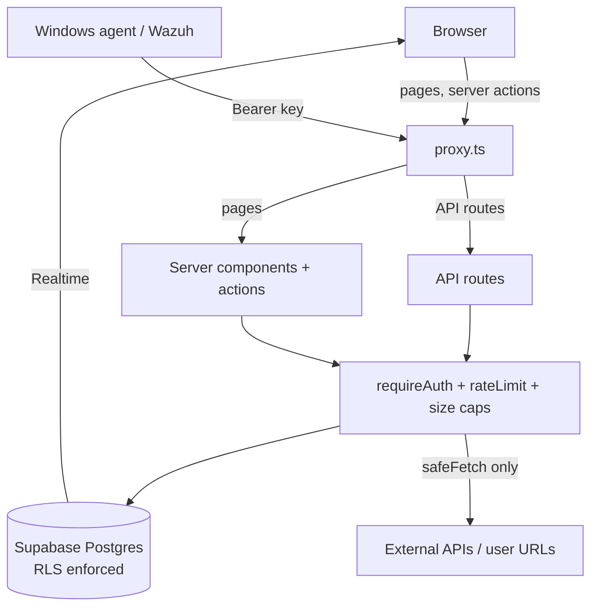

# Architecture

A map of how ThreatLens is put together: how a request travels, where each rule is enforced, what the
database holds, and how demo mode works. Read this before changing anything security-related.

## The big picture

Everything runs in one Next.js app. There is no separate backend service.

## Request lifecycle

1. **`src/proxy.ts`** runs first on every request.
   - For `/api/*`: applies a per-IP rate limit (60 per minute, 120 for agent routes), then passes the request on.
   - For pages: refreshes the Supabase session, redirects strangers to the login page and, for
     `/dashboard` and every **server action**, checks that the signed-in user is **authorized** (on the invite
     list). Admin-only pages are gated here too.
2. **Route handlers and server actions** call `requireAuth` (`src/lib/api-auth.ts`), then `rateLimit` for
   costly services, then check body size with `rejectLargeBody` and validate their input.
3. **Database access** goes through Supabase. User-facing queries use the signed-in user's token, so
   **row-level security** applies. A few server-only jobs use the secret key, which bypasses RLS.
4. **Outbound requests** to anything a user supplied go through `safeFetch`.

## Authentication vs authorization

| Concept | Meaning | Where |
|---|---|---|
| Authentication | Who you are: a valid Supabase session from Google | `getUser()` (server-verified) |
| Authorization | Whether you may use the app: an unexpired invite | `src/lib/authorization.ts`, `is_authorized()` in SQL |

Authorization trusts only data Supabase sets itself (linked identities, confirmed email), never the
user-editable profile metadata. It **fails closed**: if the lookup errors, access is denied.

## Key modules (`src/lib`)

| File | Responsibility |
|---|---|
| `api-auth.ts` | `requireAuth(request, options)`: session or agent key, admin-only, demo blocking |
| `authorization.ts` | Is this user invited / an admin? Cached for 30 seconds |
| `action-guard.ts` | The same checks plus rate limits for **server actions** |
| `rate-limit.ts` | Per-user, per-IP, per-email and daily-cap limits (Upstash or in memory) |
| `limits.ts` | Size caps and input maxima, `rejectLargeBody`, `clip` |
| `safe-fetch.ts` | SSRF guard: public IPs only, validated per connection, redirect and size limits |
| `prefill.ts` | Signed cookie carrying a Google-verified name and email to the access form |
| `discord-log.ts` | Security-event webhook with clipped, mention-safe content |
| `cisa-kev.ts` | CISA exploited-vulnerability catalog, cached in memory |
| `demo.ts`, `demo/` | Demo-mode switch, fixtures and an in-memory fake Supabase client |
| `scanner/` | DNS, HTTP, WHOIS, OSINT and scoring helpers |
| `wazuh/api.ts` | Wazuh manager API client (active response) |

## Where each defence lives

| Threat | Defence |
|---|---|
| Uninvited user reads pages or calls APIs | Proxy gate, `requireAuth`, RLS |
| Using the public Supabase key from a script | RLS policies on every table |
| User promotes themselves to admin | Triggers `guard_invite_update`, `guard_profile_write`; admin-only checks |
| Forged identity on the access form | Name, email and Discord ID come only from a signed, short-lived cookie |
| Bots on the access form | Turnstile verified server-side, per-IP and per-email limits |
| SSRF through the website scanner or domain scan | `safeFetch` and request interception in Chromium |
| Command injection | WHOIS runs with `execFile` and a validated hostname, never a shell |
| Open redirect after sign-in | `next` must be a relative path |
| API key theft or abuse | Server-side keys, per-user and daily caps |
| Oversized input | `Content-Length` caps and per-field limits |
| Stolen agent key | Constant-time compare, per-IP limits, easy rotation |

## Data model

Tables, grouped by purpose (see `supabase/schema.sql` for every column):

| Area | Tables |
|---|---|
| Incidents | `case`, `case_note`, `case_mitre`, `case_pcap`, `case_hex`, `case_ioc`, `investigations`, `evidence`, `forensic_artifacts`, `note` |
| Indicators | `ioc`, `iocs`, `ioc_tags` |
| Threat intel | `threat_actors`, `campaigns`, `malware_families`, `threatfeed`, `feed` |
| Telemetry and automation | `endpoint_logs`, `detection_rules`, `soar_playbooks` |
| Domain monitoring | `threatlens_domains`, `threatlens_scans`, `threatlens_findings`, `api_findings` |
| People and audit | `iam_discord_invites`, `profiles`, `audit_logs` |

Note that there are **two indicator tables**. `ioc` feeds the dashboard counters, the threat map, the SIEM
rule action "Flag IOC" and the Wazuh webhook. `iocs` (with `ioc_tags` and campaigns) backs the **IOC Database**
page and the hunting engine. They are not linked, so the dashboard's "Indicators tracked" counts `ioc` while
the IOC Database page lists `iocs`. Treat unifying them as a good first contribution.

Realtime: the dashboard subscribes to `ioc`, `case`, `feed`, `endpoint_logs`, `soar_playbooks` and
`iam_discord_invites`.

## Demo mode

`src/lib/demo.ts` decides the mode. When it is on:

- `createClient()` in `src/utils/supabase/{client,server}.ts` returns an **in-memory fake** from
  `src/lib/demo/mock-supabase.ts`: a small query builder (select, insert, update, delete, upsert, filters,
  ordering, embedded selects), a fake `auth`, and no-op realtime channels.
- Data comes from `src/lib/demo/data.ts` (all synthetic).
- `requireAuth` returns a read-only "demo analyst"; the proxy skips the session gate.
- Every mutating server action and every outbound route refuses with "disabled in demo mode".

Because the module-level code must not need configuration, anything that creates a Supabase client at import
time is lazy (see the SIEM and Wazuh routes).

## Frontend

- App Router with server components for data pages and client components for interactive parts.
- UI built from shadcn/ui (`src/components/ui`, base-nova style) plus Kibo UI (`src/components/kibo-ui`).
- Charts use Recharts through the shadcn chart wrapper; the world map uses d3-geo and `world-atlas`; the globe
  uses `react-globe.gl`.
- Tailwind CSS 4, with theme tokens in `src/app/globals.css`.
- Avatars load through `/api/avatar`, an allow-listed same-origin proxy with an initials fallback.

## Adding a feature safely

1. New API route? Start from an existing one: `requireAuth`, then `rateLimit`, then `rejectLargeBody`, then
   validate.
2. New server action? Use `guardAction` (outbound) or `blockInDemo` (mutating).
3. New table? Add it to `supabase/schema.sql` with RLS enabled and the standard policies.
4. New outbound fetch of a user-supplied URL? `safeFetch`, never plain `fetch`.
5. Check it in demo mode: it must either work on fixtures or refuse cleanly.
